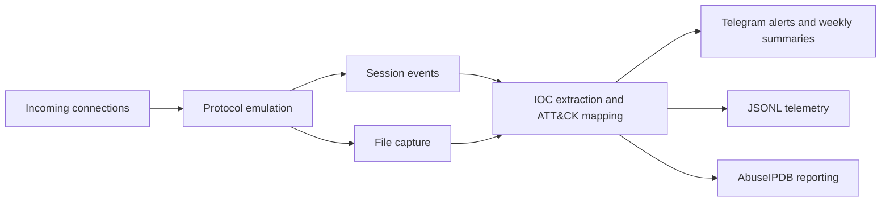
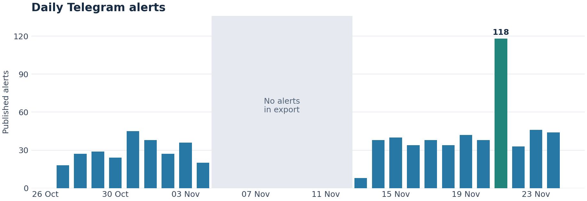
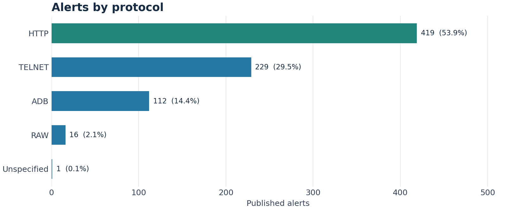
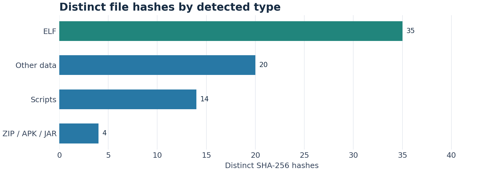

# BotBait — November 2026 field report

**27 October – 24 November 2026** · IoT security / honeypot research  
[Project repository](https://github.com/generalregulator/botbait) · [Aggregate data](metrics.csv) · [Weekly data](weekly-digests.csv)

## 1. What I wanted to find out

BotBait is my open-source project for observing attacks against Internet-facing IoT services. The idea is to imitate vulnerable devices without actually giving an attacker access to a real system. I wanted to see what automated scanners do after connecting, which services they target, and what kinds of files they attempt to deliver.

This report covers the first available monitoring period in my Telegram archive. It is a field report rather than a controlled experiment. The aim is to document what the sensor observed and what the data can (and cannot) tell me.

## 2. Results at a glance

| Metric | Count |
| :--- | ---: |
| Network sessions in three available weekly digests | **310,231** |
| Attacks recorded in those digests | **1,687** |
| Individual alerts in the Telegram export | **777** |
| Distinct source IP addresses in those alerts | **307** |
| Distinct SHA-256 file hashes in those alerts | **73** |
| IP reports counted across the weekly digests | **325** |

The first two numbers are sensor counters. The alert counts are a separate view of the same monitoring project, not additional attacks to add to the sensor totals. One weekly digest is missing from the export.

## 3. How BotBait collects data

The sensor is written in Go. It imitates ADB, Telnet, TR-069 and several camera/DVR web interfaces, including Hikvision, Dahua and TVT. It records incoming requests, extracts indicators of compromise (IOCs), assigns ATT&CK technique labels and sends selected events to Telegram. The project also supports AbuseIPDB reporting and structured JSONL logs for offline analysis.

The most important design choice is to emulate a shell rather than expose a real one. Captured files are identified by SHA-256 and stored without execute permissions, according to the project design. Attacker commands are not run on the host. This report does not independently audit those safety controls.

### Data used in this report

I used two kinds of records from the `Malware Report's` Telegram channel:

- Individual honeypot alerts, dated from 27 October at 09:22 to 24 November at 18:11 (UTC+5).
- Weekly digests, which contain broader sensor counters and report periods in UTC.

For the alert analysis, each message marked `HONEYPOT ALERT` is counted once. Source addresses and file hashes are deduplicated separately across those messages. Protocols are taken from alert headers, and file types and ATT&CK labels are taken from the sensor's own classifications. One alert may contain several files or techniques. The public CSV files contain aggregate counts only.

## 4. Weekly sensor activity

| Digest period (UTC) | Sessions | Unique IPs | Attacks | Samples captured | IP reports |
| :--- | ---: | ---: | ---: | ---: | ---: |
| Oct 26 – Nov 2 | 227,192 | 1,622 | 459 | 28 | 94 |
| Nov 2 – Nov 9 | — | — | — | — | — |
| Nov 9 – Nov 16 | 32,755 | 784 | 333 | 20 | 77 |
| Nov 16 – Nov 23 | 50,284 | 1,966 | 895 | 34 | 154 |
| **Available totals** | **310,231** | — | **1,687** | **82** | **325** |

The first digest accounts for roughly 73% of all sessions in the three available summaries. However, the last digest has the largest recorded attack count: 895. A high volume of connections does not necessarily mean a high volume of events classified as attacks.

I did not sum weekly unique IP counts because the same address can appear in multiple weeks. The sample and IP reporting totals are sums of weekly counters, not counts of distinct files or distinct addresses for the entire period. The missing digest and the final days after 23 November are not included in these totals.

## 5. What appeared in the individual alerts

### Activity over time

The busiest day in the archive was 21 November, with 118 alerts. There are no individual alerts in the export from 5 to 12 November. I cannot establish whether the sensor was offline, notifications were interrupted, or activity simply was not published. In fact, the weekly summary covering 9–16 November contains sensor activity, so the gap should not be interpreted as eight attack-free days.

### Protocols and exposed services

| Protocol label | Alerts | Share |
| :--- | ---: | ---: |
| HTTP | 419 | 53.9% |
| Telnet | 229 | 29.5% |
| ADB | 112 | 14.4% |
| RAW | 16 | 2.1% |
| Unspecified | 1 | 0.1% |

HTTP was the most frequent protocol in individual alerts. Most of those were labelled `80/HTTP` (317 alerts). Telnet was next, followed by ADB. The one alert without a protocol label was left unspecified rather than assigned to ADB based on its port alone.

The weekly summaries tell a different part of the story. In the first digest, ADB accounted for 80.77% of recorded sessions by target port. In the next two available digests, Telnet on port 23 accounted for 90.47% and 87.44%, respectively. The alert distribution therefore should not be used as a direct measure of all incoming traffic.

## 6. File collection

| Detected type | Distinct SHA-256 hashes |
| :--- | ---: |
| ELF executables | 35 |
| Other data | 20 |
| Scripts | 14 |
| ZIP / APK / JAR | 4 |
| **Total** | **73** |

ELF was the largest file category, making up 47.9% of the distinct hashes. Scripts and Android-related archives were also recorded. Some entries classified as `data` are small artifacts written during emulated sessions; it would be misleading to call every captured artifact a malware sample.

A SHA-256 hash identifies a file by its content, not its malware family. Different hashes do not necessarily represent different malware families, and a repeated hash does not indicate a new sample. I have not performed a full reverse-engineering or independent malware-classification study of the collected files.

### Two examples from 27 October

**ADB file delivery.** One session recorded an uploaded ELF binary and an attempt to retrieve an Android package. The alert included SHA-256 hashes and file sizes for both artifacts. This shows why recording file transfers, rather than just shell text, is useful.

**Repeated Telnet activity.** Several sessions from two recurring source addresses included different login attempts but produced the same small file artifacts. The repeated behavior is consistent with automation. It also illustrates why deduplication matters: repeated sessions can make file collection counts look larger without adding new file content.

These are observations of attempted activity against an emulated service. They are not evidence of successful compromise of a real IoT device.

## 7. Observed attacker behavior

The sensor applies rule-based MITRE ATT&CK labels to individual alerts. The six technique labels found in the export are listed below.

| Technique | Alerts containing the label |
| :--- | ---: |
| [T1059.004](https://attack.mitre.org/techniques/T1059/004/) — Unix Shell | 592 |
| [T1105](https://attack.mitre.org/techniques/T1105/) — Ingress Tool Transfer | 375 |
| [T1190](https://attack.mitre.org/techniques/T1190/) — Exploit Public-Facing Application | 369 |
| [T1110.001](https://attack.mitre.org/techniques/T1110/001/) — Password Guessing | 228 |
| [T1082](https://attack.mitre.org/techniques/T1082/) — System Information Discovery | 73 |
| [T1496](https://attack.mitre.org/techniques/T1496/) — Resource Hijacking | 11 |

Unix shell activity was the most common label, present in 76.2% of alerts. The sum of the table exceeds 777 because a single session may involve multiple behaviors.

The weekly digests also identified signatures associated with Hikvision vulnerabilities (CVE-2021-36260 and CVE-2017-7921) and a Dahua vulnerability (CVE-2021-33045). A signature match is an indication of an attempted exploit pattern, not proof of successful exploitation or attribution to a particular botnet.

## 8. Limitations and responsible handling

- The data comes from the available Telegram export, not a complete set of raw session logs. Alerting rules affect which events are visible.
- The missing digest prevents an exact month-wide session or attack total. No missing data was estimated.
- Rule-based labels and file-type detection can be wrong. They are useful for initial triage, but further validation is needed.
- Source IP addresses are not equivalent to individual attackers. Proxies, hosted servers and previously compromised devices can all appear in the logs.
- No live payloads, raw attacker commands, IP addresses or malware download URLs are included in this public report. The accompanying data is aggregated.

## 9. Next steps

For the next reporting period, I want to focus on three improvements:

1. Produce the statistics directly from JSONL session logs and compare the results against the Telegram summaries.
2. Track the uptime and completeness of the monitoring pipeline, so gaps in the archive can be explained.
3. Improve validation of ATT&CK classifications and group recurring file artifacts by hash and type before attempting malware-family analysis.

## 10. Conclusion

The available monitoring data shows that BotBait can record several kinds of IoT-targeted activity, including password guessing, attempted shell access, exploit patterns and file transfers. The main takeaway for me is that a useful honeypot needs more than realistic protocol responses. It also needs careful event collection, deduplication and reporting that makes clear what was actually observed.

This is an initial field report, not a claim that BotBait detects every attack. The next step is to improve the quality and reproducibility of the data rather than simply increase the number of alerts.

## References and data

- [BotBait source code and documentation](https://github.com/generalregulator/botbait)
- [MITRE ATT&CK](https://attack.mitre.org/) — technique identifiers and terminology
- [AbuseIPDB](https://www.abuseipdb.com/) — IP reputation and reporting service
- Primary data: `Malware Report's` Telegram HTML export, 27 October – 24 November 2026; raw export not redistributed in this report.
- Public aggregates: [`metrics.csv`](metrics.csv) and [`weekly-digests.csv`](weekly-digests.csv).
